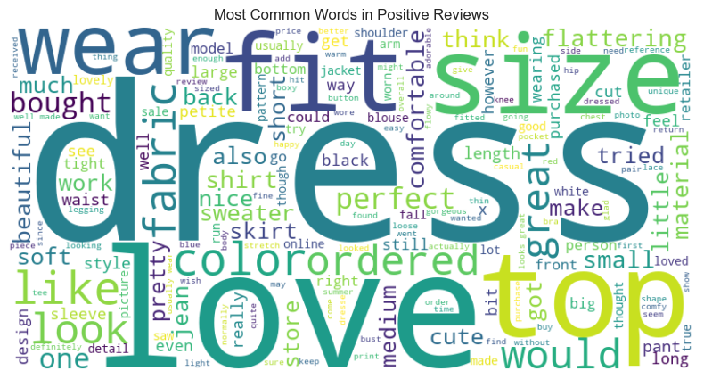
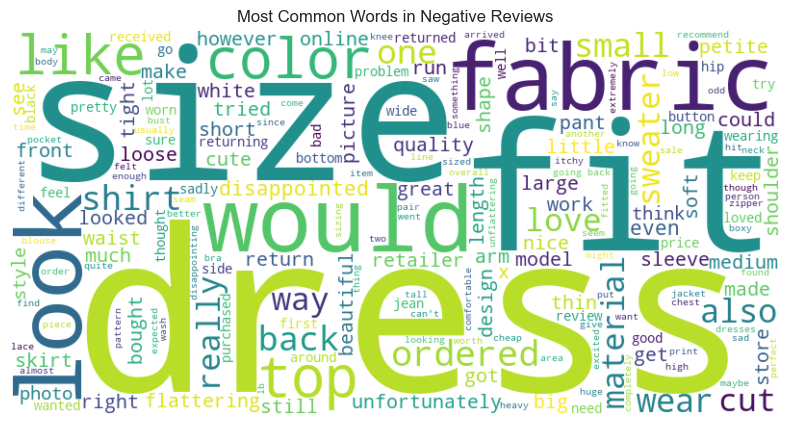

# Customer Sentiment Analysis for E-Commerce Fashion

## 🎯 Business Problem
This project analyzes customer review text to automatically classify sentiment and identify the key drivers of customer satisfaction and dissatisfaction. The goal is to provide actionable insights for an e-commerce clothing business to improve its products and marketing.

## 📊 Data
The analysis uses the "Women's E-Commerce Clothing Reviews" dataset from Kaggle, which contains thousands of real customer reviews.

## 🛠️ Methodology
1.  **Data Cleaning:** The dataset was loaded, and reviews with missing text were removed.
2.  **Sentiment Scoring:** The VADER (Valence Aware Dictionary and sEntiment Reasoner) library was used to assign a compound sentiment score (from -1 for negative to +1 for positive) to each review.
3.  **Theme Identification:** The text from positive and negative reviews was aggregated separately, and Word Clouds were generated to visualize the most frequently used terms in each category.

## ✅ Results & Insights
The analysis revealed a strong positive sentiment overall, but also highlighted specific areas for improvement.

### Positive Feedback Themes
Customers who left positive reviews frequently mentioned terms related to **fit, comfort, and style**. The most common words were **"love," "great," "fit," "flattering," and "comfortable."** This indicates that the brand's core strengths lie in its design and wearability.

### Negative Feedback Themes
Negative reviews consistently focused on issues with **sizing and material quality**. The most frequent words were **"small," "fabric," "disappointed," "return," and "cheap."** This provides a clear signal that the business should focus on providing more accurate sizing guides and improving fabric quality to reduce customer dissatisfaction.

## 🚀 How to Run
1. Clone this repository.
2. Create and activate a Python virtual environment.
3. Install the required packages: `pip install -r requirements.txt`
4. Run the `sentiment_analysis.ipynb` Jupyter Notebook.# Customer Sentiment Analysis for E-Commerce Fashion